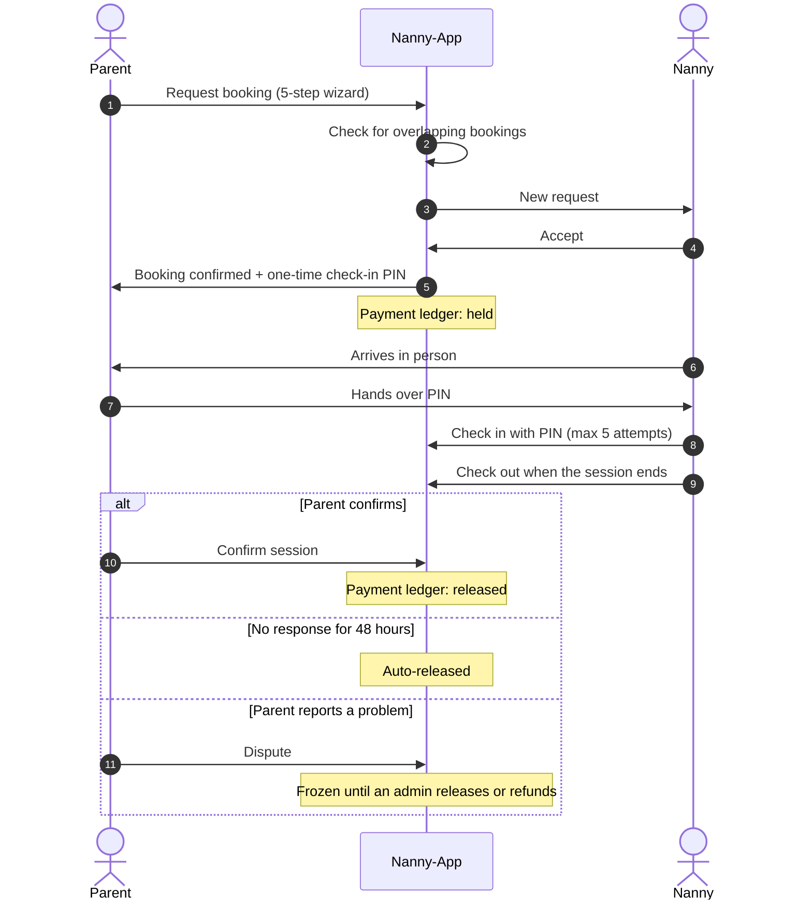
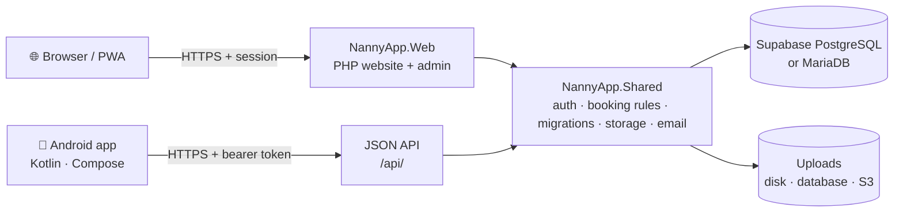

<div align="center">


# Nanny-App

**Trusted childcare booking for parents, verified nannies and the admins who keep it safe.**

One platform, three clients' worth of reach: a PHP website and installable PWA, a native Android app, and a shared backend that keeps accounts, bookings, messages and payments in sync across both.

[](https://github.com/jBlack-MC/NannyApp/actions/workflows/ci.yml)
[](https://github.com/jBlack-MC/NannyApp/actions/workflows/production-verify.yml)
[](https://github.com/jBlack-MC/NannyApp/actions/workflows/workflow-checks.yml)


[**🌐 Live site**](https://nannyapp-two.vercel.app) &nbsp;·&nbsp;
[**📱 Download Android**](https://nannyapp-two.vercel.app/download-app.php?platform=android) &nbsp;·&nbsp;
[**▶️ Demo video**](https://youtu.be/nO85AqjW2E4) &nbsp;·&nbsp;
[**📚 Docs**](docs/README.md) &nbsp;·&nbsp;
[**⚙️ CI runs**](https://github.com/jBlack-MC/NannyApp/actions)

<sub>Module XISD6329 — Work Integrated Learning 3B</sub>

</div>

---

## 🎬 Demo video

<div align="center">

[](https://youtu.be/nO85AqjW2E4)

**[▶️ Watch the full walkthrough on YouTube](https://youtu.be/nO85AqjW2E4)**

</div>

## 📑 Table of contents

| Get started | Understand it | Ship it |
| --- | --- | --- |
| [Demo video](#-demo-video) | [Features](#-features) | [Testing](#-testing) |
| [Highlights](#-highlights) | [How a booking works](#-how-a-booking-works) | [CI/CD](#-cicd) |
| [Demo accounts](#-demo-accounts) | [Architecture](#-architecture) | [Deployment](#-deployment-and-production) |
| [Quick start](#-quick-start) | [Tech stack](#-tech-stack) | [Security](#-security) |
| [Repository structure](#-repository-structure) | [Database and migrations](#-database-and-migrations) | [Roadmap](#-roadmap-and-status) |
| | [Engineering notes](#-engineering-notes) | [Documentation](#-documentation) |

## ✨ Highlights

- **One account, every device.** Register on the web or in the Android app and sign in on the other. Web sessions and Android bearer tokens share the same users, rules and revocation.
- **Proof of presence before payment.** A nanny can only start a session with a one-time PIN the parent hands over in person, and payment is only marked released once the parent confirms the session.
- **Verified nannies only.** Admins review documents before a nanny appears in search.
- **No double-booking.** Overlap checks are serialized across web and API booking creation and rescheduling.
- **Admin stays on the web.** The admin area is blocked server-side inside the Android app, an installed PWA and the mobile API.
- **Lean by design.** Plain PHP — no framework, no Composer, no frontend build step.

> [!NOTE]
> **Payments are manual in the current pilot.** `held`, `released` and `refunded` are ledger states that record decisions. The app does not charge cards, transfer funds or act as an escrow service.

## 🔑 Demo accounts

Use these on the hosted site, [nannyapp-two.vercel.app](https://nannyapp-two.vercel.app):

| Role | Email | Password | Where to sign in |
| --- | --- | --- | --- |
| 🛡️ Admin | `admin@nanny.app` | `WaVjn6BjrZr5YzLfSP0rI2Nh` | Normal web browser only |
| 👪 Parent | `parent@nanny.app` | `Hxiz4M5X2EJm_ZzxtzuWK432` | Web and Android |
| 👪 Parent | `james@nanny.app` | `JZ1bs1wOUbxLpjv_1etNV9gX` | Web and Android |
| ✅ Verified nanny | `amelia@nanny.app` | `PPCfXm6dZDtCzqdi7piqk5jG` | Web and Android |
| ⏳ Pending nanny | `grace@nanny.app` | `3dC7I8zC23JEYN20U45EM99d` | Web and Android (verification restrictions apply) |

> [!IMPORTANT]
> `Password123!` is the **local development** password for accounts seeded by the Docker stack. It does not work on the hosted site.

- Supabase keys and the database password are not app logins. Both clients authenticate against the application's own `users` table, not Supabase Auth.
- Install Android from the [website download link](https://nannyapp-two.vercel.app/download-app.php?platform=android), not an old `app/release/` file. Release APKs must point to `https://nannyapp-two.vercel.app/api/`.
- Seeding and password rotation: [demo account operations](docs/DEMO_ACCOUNTS.md). Rotate these passwords and disable the demo accounts before real users join.

## 🚀 Quick start

### Docker (recommended)

```sh
docker compose -f deploy/local/compose.yml up -d --build
docker compose -f deploy/local/compose.yml run --rm seed
```

Open **http://localhost/** and sign in with any demo email and `Password123!`. Rerunning the seed can add duplicate sample bookings. Ports, emulator/phone addresses and shutdown: [local development](docs/LOCAL_DEVELOPMENT.md).

### Android

1. Open `NannyApp.Mobile/NannyApp` in Android Studio with **JDK 21**.
2. Run on an emulator — it defaults to `http://10.0.2.2/nannyapp/api/`. A physical phone needs a reachable LAN or HTTPS API address.
3. Release builds require `NANNYAPP_RELEASE_API_URL` as a Gradle property or environment variable.

Prefer no install? Open the website in Chrome on Android and choose **Install app** to use the PWA.

<details>
<summary><strong>XAMPP setup (without Docker)</strong></summary>

1. Place the project in `C:\xampp\htdocs\`, keeping `NannyApp.Shared` next to `NannyApp.Web`. Its `.htaccess` blocks direct browser access.
2. Create an empty database and set `NANNYAPP_DB_HOST`, `NANNYAPP_DB_PORT`, `NANNYAPP_DB_NAME`, `NANNYAPP_DB_USER` and `NANNYAPP_DB_PASS`.
3. From the repository root, run `php NannyApp.Shared/bin/migrate.php`.
4. Configure base URL, email and storage through environment variables — never put production secrets in tracked PHP files.
5. Open the site in your browser.

</details>

<details>
<summary><strong>Requirements</strong></summary>

| Tool | Version |
| --- | --- |
| Docker Desktop | Current (recommended path) |
| PHP | 8.3 (matches CI) |
| MariaDB | 10.11 (matches CI) — validate migrations before using another version |
| Android Studio | Current, with JDK 21 |
| Python | 3.x for the test scripts |

</details>

## 🧩 Features

<table>
<tr>
<th width="33%">👪 Parents</th>
<th width="33%">🧑‍🍼 Nannies</th>
<th width="33%">🛡️ Admins</th>
</tr>
<tr valign="top">
<td>

- Family profile and child profiles (allergies, medical notes, special needs)
- Search verified nannies by location, rate, skills, experience and gender
- 5-step booking wizard, conflict-checked
- One-time check-in PIN per booking
- Confirm sessions to release payment, or report a problem to freeze it
- Cancel before check-in; refunds recorded
- Saved nannies, ratings and reviews
- Payment history with payout status
- Live in-app messaging and notifications

</td>
<td>

- Profile with bio, rate, skills, languages and qualifications
- Photo, banner and certification uploads
- Weekly availability
- Accept or reject requests
- Check in with the parent's PIN, then check out
- Earnings split into held and released, with a monthly chart
- Read and respond to reviews
- Profile completeness and trust score
- Live in-app messaging

</td>
<td>

- Platform statistics dashboard
- Nanny verification queue with document review
- Suspend, unsuspend and delete users
- Booking and payment oversight; release or refund held/disputed entries
- Support tickets and contact inbox
- Broadcast notifications
- Operations page: queues and system health
- Own admin profile
- **Web browser only**

</td>
</tr>
</table>

**Platform-wide:** role-based access on every page and endpoint · CSRF protection · bcrypt passwords · email verification · one-use, 1-hour password-reset tokens · login and chat rate limiting · persistent dark mode with no flash · responsive layout · installable PWA.

<details>
<summary><strong>Role capabilities at a glance</strong></summary>

```text
GUEST    Browse nannies (read-only) · landing, pricing, FAQ, safety, contact

PARENT   Book nannies · manage, cancel, confirm or dispute bookings
         Share check-in PIN · manage children and saved nannies
         Payment history · reviews · messages · notifications · account

NANNY    Profile and documents · weekly availability · accept/reject requests
         Check in with PIN, check out · earnings (held vs released)
         Reviews · messages · notifications · account

ADMIN    (normal web browser only — blocked in the app, installed PWA and mobile API)
         Verify nannies · manage users · all bookings and payments
         Release/refund held or disputed entries · support tickets · contact inbox
         Broadcast notifications · operations and system health · own profile
```

</details>

## 🔄 How a booking works



## 🏗️ Architecture



| Component | Implementation | Guide |
| --- | --- | --- |
| Website and administration | PHP 8.3, PDO, vanilla JavaScript, PWA | [Web](NannyApp.Web/README.md) |
| Android | Kotlin, Jetpack Compose, Hilt, Retrofit, Room | [Mobile](NannyApp.Mobile/README.md) |
| JSON API | PHP under `NannyApp.Mobile/NannyApp/api/`, served at `/api/` | [API and Android setup](NannyApp.Mobile/NannyApp/README.md) |
| Shared services | Authentication, migrations, storage, queues and booking rules | [Shared](NannyApp.Shared/README.md) |
| Database | Supabase PostgreSQL (hosted); MariaDB (local) | [Migration order](NannyApp.Shared/database/MIGRATION_ORDER.md) |

- Android never connects to the database directly — only through the API over HTTPS.
- Both PHP frontends require the adjacent `NannyApp.Shared` folder.
- Private media is served only through authorized endpoints. Storage can be local disk, the database (from migration v12, good for small Vercel deployments) or private S3-compatible storage (recommended as uploads grow).

## 🛠️ Tech stack

| Layer | Technology |
| --- | --- |
| Server | PHP 8.x — no framework, no Composer, no build step |
| Database | Supabase PostgreSQL or MySQL/MariaDB via PDO |
| Mobile | Kotlin, Jetpack Compose, Hilt, Retrofit, Room |
| Front end | Vanilla JS, modular CSS design system (`NannyApp.Web/assets/css/`) |
| Fonts and icons | Manrope and Sora (self-hosted, OFL 1.1) · Lucide SVG icons (ISC) |
| Auth | PHP sessions (web), bearer tokens (Android), email verification, reset tokens |
| Email | Shared outbox; logged to `storage/email_logs/` on localhost |
| Storage | Local disk, database or S3-compatible object storage |
| PWA | `manifest.webmanifest` + network-first `service-worker.js` |
| Hosting | Vercel + Supabase, or AWS |
| CI/CD | GitHub Actions |

## 📂 Repository structure

<details>
<summary><strong>Expand the folder tree</strong></summary>

```text
NannyApp/
├── README.md                  Project overview (this file)
├── compose.test.yml           MariaDB test environment
├── compose.postgres-test.yml  PostgreSQL test environment
├── vercel.json                Vercel routing/config
├── api/                       Vercel entry point for the JSON API
├── deploy/
│   ├── local/                 Docker Compose stack for local development
│   └── aws/                   AWS deployment files
├── docs/                      Product, deployment and deliverable documentation
├── tests/                     Automated checks and validation scripts
│
├── NannyApp.Web/              PHP website + PWA
│   ├── index.php              Landing page
│   ├── account.php            Account settings and password change
│   ├── messages*.php          Chat page and AJAX send/poll endpoints
│   ├── notifications.php      Notification centre
│   ├── support.php            Support ticket submission
│   ├── media.php              Authorized access to shared uploads
│   ├── download-app.php       Current signed Android APK download
│   ├── admin-unavailable.php  Shown when admin is opened inside the app/PWA
│   ├── manifest.webmanifest   PWA manifest
│   ├── service-worker.js      PWA offline shell
│   ├── auth/                  Login, registration, verification and recovery
│   ├── parent/                Dashboard, search, booking wizard, bookings, children, payments, reviews, saved
│   ├── nanny/                 Dashboard, profile, bookings, availability, earnings, reviews
│   ├── admin/                 Dashboard, verifications, users, bookings, payments, reports, support, contacts, notify, operations
│   ├── pages/                 About, contact, FAQ, pricing, safety, resources, community, privacy, terms
│   ├── config/                App bootstrap and database wiring
│   ├── includes/              Shared helpers, header, navbar, footers, sidebar
│   ├── apk/                   Legacy WebView wrapper notes
│   └── assets/                CSS, JS, fonts, icons, images
│
├── NannyApp.Mobile/           Native Android app + PHP JSON API
│   └── NannyApp/
│       ├── app/               Kotlin / Jetpack Compose client
│       ├── api/               PHP REST API served at /api/
│       ├── config/ includes/  API bootstrap and helpers
│       └── backend_docs/      API documentation
│
└── NannyApp.Shared/           Shared backend layer
    ├── bin/migrate.php        Versioned migration runner
    ├── config/                Database, storage and security configuration
    ├── database/              Canonical schema, migrations v2–v14, PostgreSQL restrictions
    ├── storage/               Local uploads (blocked from direct web access)
    └── releases/              Signed Android release artefacts
```

</details>

## 🗄️ Database and migrations

`NannyApp.Shared/database/` is the single source of truth for the schema.

```sh
php NannyApp.Shared/bin/migrate.php
```

Run it from the repository root with the target database set explicitly, or use the Supabase sync workflow. The runner takes an advisory lock, records checksums and refuses changed migrations. It never creates accounts — demo seeding is a separate, explicit step.

> [!CAUTION]
> Never import a drop-and-seed schema, fixture or historical dump into a populated, staging or production database. Older `schema.sql` revisions were destructive; the current one is idempotent.

<details>
<summary><strong>Migration sequence</strong></summary>

| Order | File | Adds |
| --- | --- | --- |
| 1 | `schema.sql` | Core tables (idempotent, no demo accounts) |
| 2 | `migrate_v2.sql` | Children, saved nannies, portfolio, availability, page content, constraints, indexes |
| 3 | `migrate_v3.sql` | Support tickets, password resets, email verification, availability slots, booking refs |
| 4 | `migrate_v4.sql` | Admin profiles, check-in PIN and timestamps, confirmation, disputes, payout status |
| 5 | `migrate_v5_api.sql` | Mobile API support |
| 6 | `phase1_constraints.sql` | Extra unique constraints and indexes |
| 7 | `phase2_authentication.sql` | Authentication columns |
| 8 | `migrate_v6_security.sql` | Security hardening |
| 9 | `migrate_v7_email_outbox.sql` | Email outbox |
| 10 | `migrate_v8_operations.sql` | Operational queues |
| 11 | `migrate_v9_reports_holidays.sql` | Safety-report links, public holiday cache |
| 12 | `migrate_v10_plus_translation.sql` | Plus features and translation |
| 13 | `migrate_v11_deliverables.sql` | Project deliverables |
| 14 | `migrate_v12_sessions_downloads.sql` | Session revocation, APK metrics, persistent prototype uploads |
| 15 | `migrate_v13_shared_sessions.sql` | Shared web/API sessions |
| 16 | `migrate_v14_contact_messages.sql` | Contact inbox |
| — | `postgres/` | PostgreSQL-only access and integrity restrictions (Supabase) |

Historical web migration URLs (`migrate_v2.php` etc.) now return 404. Full guidance: [MIGRATION_ORDER.md](NannyApp.Shared/database/MIGRATION_ORDER.md).

</details>

If `/admin/operations.php` reports missing tables, the upgrade is incomplete: trace the error reference in the server logs, apply the migrations and check `/api/health.php`.

## 🧪 Testing

```sh
python tests/docker-checks.py              # PHP/MariaDB security suite (isolated, self-cleaning)
python tests/docker-checks.py --postgres   # PostgreSQL HTTP integration suite
python tests/check-readmes.py              # README links and credential patterns
python tests/check-theme-contrast.py       # Web and Android theme contrast
```

```sh
# From NannyApp.Mobile/NannyApp (use gradlew.bat on Windows)
./gradlew --no-daemon :app:assembleDebug :app:testDebugUnitTest :app:lintDebug
```

The database suites build disposable synthetic databases and cover registration and login, authorization, shared web/API data, migrations, session revocation and cache boundaries. PostgreSQL also covers parent/nanny signup in both clients and authenticated admin routes. More: [test guide](tests/README.md) · [automation](docs/AUTOMATION.md).

## 🔁 CI/CD

| Pipeline | Trigger | What it does |
| --- | --- | --- |
| **CI** | PRs, `main` pushes, manual, weekly | MariaDB/PHP security, PostgreSQL integration, Android build/unit/lint, README and deliverable checks |
| **Workflow validation** | PRs, `main` pushes, manual, weekly | actionlint for workflow syntax and shell expressions |
| **Vercel** | PRs and production branch | Preview and production web/API deployments |
| **Production verification** | After deploys, manual, daily | Read-only health, login/register availability, private API denial, cache headers |
| **Supabase database sync** | Manual on protected `main` | Versioned schema upgrade; optional explicit demo seeding |
| **Android release** | Manual on protected `main` + merged version tag | Signed APK, backend URL/signature checks, GitHub release |
| **Demo accounts** | Manual on protected `main` | Create missing named demo accounts from a private secret |

`main` is protected: a PR, one approval, resolved conversations and passing security, Android and deliverables checks are required. CI never deploys; database sync and Android publishing are separate manual dispatches. Production credentials never reach PR tests. Full setup, secrets and rollback: [CI/CD guide](docs/CI_CD.md).

## 🧠 Engineering notes

<details>
<summary><strong>Page controller pattern and shared helpers</strong></summary>

Each website URL maps to one PHP file containing its logic and view — no MVC framework or router. `NannyApp.Web/config/config.php` bootstraps the app; `NannyApp.Shared/config/database.php` provides the shared PDO singleton `db()`. `includes/functions.php` supplies `current_user()`, `require_role()`, CSRF helpers, flash messages, `notify()`, `send_email()`, rate limiting, `send_chat_message()`, `is_native_app_request()` and `auto_release_stale_payments()`.

</details>

<details>
<summary><strong>Payment ledger</strong></summary>

Each payment row has a charge status and a separate `payout_status` (`held` / `released` / `refunded`). Accepting a booking sets `held`. The 6-digit check-in PIN is visible only to the parent; wrong entries are capped at 5 and the parent can reissue it. After check-out, parent confirmation sets `released`, or it auto-releases 48 hours later. Disputes freeze the entry until an admin releases or refunds it in `admin/payments.php`. No money moves — these are recorded decisions.

</details>

<details>
<summary><strong>Web-only admin</strong></summary>

`is_native_app_request()` detects the app through a user-agent marker or an `na_app_shell` cookie set when an installed PWA runs standalone. In that case `require_role('admin')` redirects to `admin-unavailable.php`, login refuses admin credentials, stray admin sessions are ended, the mobile API refuses admin login, and the service worker never caches `/admin/`.

</details>

<details>
<summary><strong>Live chat</strong></summary>

`messages.php` renders threads server-side (works without JavaScript). `messages_send.php` posts over AJAX; `messages_poll.php` is polled every 4 seconds while the tab is visible. All paths go through `send_chat_message()`, so validation and the 30-messages-per-5-minutes rate limit stay identical.

</details>

<details>
<summary><strong>Dark mode, uploads and caching</strong></summary>

- **Dark mode:** an inline script at the top of `includes/header.php` applies `localStorage.na_theme` (or `prefers-color-scheme`) before any CSS loads — no flash, persists across pages. Contrast tokens live in `assets/css/accessibility.css`; see [theme and contrast](docs/THEME_AND_CONTRAST.md).
- **Uploads:** MIME whitelist plus `getimagesize()`, random filenames sharded by year/month, served only via `media.php`. `NANNYAPP_STORAGE_DRIVER` selects disk, database or S3.
- **Caching:** public content may be cached by the service worker; login, registration, authenticated pages and private API responses never are. Android's private caches are per-account and cleared at session boundaries. Logout revokes sessions across clients on their next request.

</details>

## ☁️ Deployment and production

Start with the [Vercel + Supabase guide](docs/VERCEL_SUPABASE_DEPLOY.md), or the [AWS alternative](docs/AWS_DEPLOYMENT.md) (`deploy/aws/`). Stuck? See [troubleshooting](docs/TROUBLESHOOTING.md).

**Production checklist**

- [ ] Database credentials set through environment configuration, never committed
- [ ] Persistent uploads configured (database storage after v12, or S3) and live upload/readback verified
- [ ] Shared storage blocked from public web access
- [ ] Email delivery configured for verification and password resets
- [ ] Backups, monitoring and release procedures in place
- [ ] Demo passwords rotated and demo accounts disabled
- [ ] `display_errors` set to `0`
- [ ] Payments kept manual — gateway charging and webhooks are not implemented

## 🔒 Security

| Control | Implementation |
| --- | --- |
| SQL injection | PDO prepared statements, `ATTR_EMULATE_PREPARES = false` |
| XSS | All output escaped with `htmlspecialchars()` |
| CSRF | Token on every POST form, checked with `hash_equals()` |
| Passwords | `password_hash(PASSWORD_DEFAULT)` (bcrypt) |
| Abuse | Login rate limiting per IP; chat rate limiting per sender |
| Uploads | MIME validation, unpredictable filenames, authorized serving only |
| Payment fraud | Release requires the parent's in-person PIN and explicit confirmation |
| Admin exposure | Blocked inside the app, PWA and mobile API — enforced server-side |
| Direct file access | `config/`, `includes/`, `database/` and `NannyApp.Shared/` blocked |

Enforce HTTPS everywhere, rotate credentials regularly, and never publish database URLs containing credentials, signing keys or private test logs.

## 🗺️ Roadmap and status

The platform runs web and Android booking workflows, a manual payment ledger and web administration. The current focus is a **trust-and-reliability pilot**: the same account and data on web and physical Android devices, with clear admin controls for verification, support, disputes and audit. Evidence and release gates: [engineering audit](docs/deliverables/08-professional-engineering-audit.html) · [audit addendum](docs/deliverables/08-professional-engineering-audit-addendum.html).

**Now — hardening**

- [ ] Rotate exposed credentials and remove public demo passwords
- [ ] Align live configuration; verify HTTPS mobile registration, login and media readback
- [ ] Keep the bearer/session-policy suite green locally and in GitHub Actions
- [ ] Complete physical-device, accessibility, backup/restore and monitoring evidence
- [ ] Reconcile documentation and release artefacts with the current build

**Next — features**

- [ ] Payment gateway (e.g. Paystack) behind the existing ledger
- [ ] WebSocket chat instead of polling
- [ ] Native push notifications on Android
- [ ] Pagination on admin lists
- [ ] Admin content management (`page_content`)
- [ ] PDF document uploads
- [ ] Live unread badge in the navbar

<details>
<summary><strong>Known limitations</strong></summary>

| Area | Detail |
| --- | --- |
| Payments | No gateway; ledger states only, no cards charged or funds moved |
| Email | Needs a configured provider in production; logged locally on localhost |
| Chat | 4-second polling, not WebSockets |
| Pricing plans | Shown on the pricing page but not enforced in the back end |
| Legacy files | `NannyApp.Web/nanny-home.html` is an orphaned prototype; `NannyApp.Web/apk/` documents the superseded WebView wrapper |

</details>

## 📚 Documentation

| Guide | Covers |
| --- | --- |
| [NannyApp.Web](NannyApp.Web/README.md) | Website, routes and administration |
| [NannyApp.Mobile](NannyApp.Mobile/README.md) | Android app and JSON API |
| [NannyApp.Shared](NannyApp.Shared/README.md) | Database, storage and shared services |
| [Documentation index](docs/README.md) | Everything in `docs/` |
| [Local development](docs/LOCAL_DEVELOPMENT.md) | Docker stack, ports, devices |
| [Web/mobile feature map](docs/WEB_MOBILE_FEATURE_MAP.md) | Feature parity across clients |
| [Test guide](tests/README.md) | Every automated check |

**Project deliverables** ([index](docs/deliverables/README.md))

| # | Document | Formats |
| --- | --- | --- |
| 01 | Product requirements | [HTML](docs/deliverables/01-product-requirements.html) · [PDF](docs/deliverables/01-product-requirements.pdf) |
| 02 | Technical requirements | [HTML](docs/deliverables/02-technical-requirements.html) · [PDF](docs/deliverables/02-technical-requirements.pdf) |
| 03 | App flow | [HTML](docs/deliverables/03-app-flow.html) · [PDF](docs/deliverables/03-app-flow.pdf) |
| 04 | Design brief | [HTML](docs/deliverables/04-design-brief.html) · [PDF](docs/deliverables/04-design-brief.pdf) |
| 05 | Backend schema | [HTML](docs/deliverables/05-backend-schema.html) · [PDF](docs/deliverables/05-backend-schema.pdf) |
| 06 | Implementation plan | [HTML](docs/deliverables/06-implementation-plan.html) · [PDF](docs/deliverables/06-implementation-plan.pdf) |
| 07 | CI/CD and release | [HTML](docs/deliverables/07-ci-cd-and-release.html) · [PDF](docs/deliverables/07-ci-cd-and-release.pdf) |
| 08 | Professional engineering audit | [HTML](docs/deliverables/08-professional-engineering-audit.html) · [PDF](docs/deliverables/08-professional-engineering-audit.pdf) · [Addendum](docs/deliverables/08-professional-engineering-audit-addendum.html) |

---

<div align="center">

Built by **[jBlack-MC](https://github.com/jBlack-MC)** for XISD6329 — Work Integrated Learning 3B

[🌐 Live site](https://nannyapp-two.vercel.app) · [▶️ Demo video](https://youtu.be/nO85AqjW2E4) · [🐛 Report an issue](https://github.com/jBlack-MC/NannyApp/issues)

</div>
